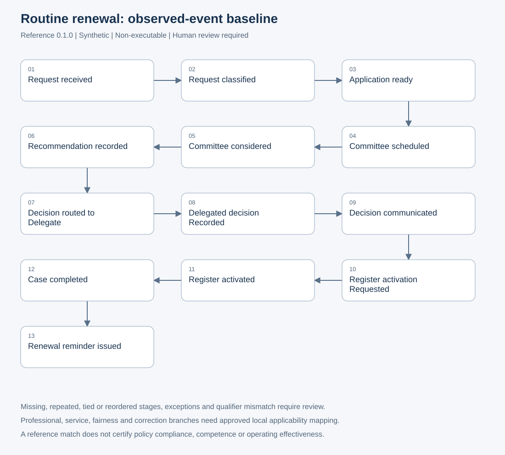

# Routine-renewal reference evidence

Version: 0.1.0. Synthetic, organisation-neutral reference; disconnected by default.

Source-system and qualifier values are code-shaped tokens: an initial ASCII
letter or digit followed by letters, digits, dots, underscores, colons or
hyphens, within the existing length limits. Sentences, email addresses and
arbitrary narratives are rejected by both the runtime and published schema.
This syntax check cannot establish that a token is non-identifying: deployment
must map approved controlled vocabularies and must never encode names or other
sensitive values as tokens. Stable object/event references likewise require
approved pseudonymisation or verified non-identifying source-local semantics.

The executable comparison is `assess_routine_renewal` in
`src/careops_process/credentialing_assurance.py`. It returns reference-model
evidence for human review, not policy certification. The caller supplies the
case reference and current authority mapping version. A matching label says
only that the recorded observed events match this generic baseline.

## Reference sequence

[BPMN source](process-models/credentialing-routine-renewal.bpmn) is explicitly
non-executable. It depicts the same thirteen stages as the comparison:
request received; request classified; application ready; committee scheduled;
committee considered; recommendation recorded; decision routed to delegate;
delegated decision recorded; decision communicated; register activation
requested; register activated; case completed; renewal reminder issued.

A [PNG rendering](process-models/credentialing-routine-renewal.png) is also
available for document and slide use.

Application readiness represents deterministic validation and officer review;
it does not prove either activity occurred without approved source mapping.
Register activation likewise does not prove successful reconciliation. The
model requires strictly increasing timestamps for its required stages. Missing
stages, repeated stages, timestamp ties or reversed order produce controlled
deviation codes. Every observed event must identify `routine-renewal` and the
supplied authority version. An empty observed trace is insufficient evidence.
Inferred events never satisfy a required stage and are counted separately as
excluded inference. No AI service is needed.

Correction, professional review, service-capability, fairness, deferral and
reconciliation events produce `additional_activity` review flags. They may be
legitimate: the baseline does not decide their applicability. Before any local
pilot, the process owner must map these branches, current authority, decision
outcomes and completion/reminder conventions to a separately reviewed local
reference. Withdrawn, superseded, temporary, changed-scope and appeal cases
need their own models. No automatic routing or source writes are performed.

## Replay and deletion boundary

Use `CredentialingLedger` for assurance ingestion. The lower-level projection
merge is an event-union helper and does not itself enforce deletion memory.
The ledger removes tombstoned events immediately and excludes them from all
future merges, even after more than 10,000 unrelated deletions. Tombstones are
never automatically evicted. Restoring an older projection with saved deletion
memory filters deleted facts before exposing the projection.

The ledger is an in-memory reference implementation. A production adapter must
atomically persist the projection, complete tombstone set, provenance and
watermark, enforce concurrency, and restore that state before replay. It must
not persist only the projection. Retention changes require an explicit policy
and migration. Watermarks retain the highest accepted source watermark; this
does not assert completeness or that all earlier events were received.

For inferred events, the ledger requires an `InferenceRun` per event ID with
bounded run ID, provider, model and agent version. Raw prompts, outputs and
free-text metadata are excluded. Run metadata remains in restricted processing
state, outside broader reports. Tombstones remove the event's provenance link.
Projection validation alone is a structural boundary; it does not verify the
existence, authorisation or accuracy of an external inference run.

Dead letters accept only `schema`, `conflicting_replay`, `throttled`, `timeout`
or `transient`. Only the last three are retryable. They retain a safe event
reference (or `unidentified`), classification, retry flag and UTC timestamp.
Callers must never copy raw validation exceptions, inputs or content into them.

## Metric dictionary and exclusions

[Machine-readable metric dictionary](../contracts/credentialing-assurance-measures.json)
defines the aggregate counters. Each retained, validated event counts once,
regardless of its number of object links. Exact replay is idempotent; changed
replay fails closed. Deleted events and rejected payloads contribute zero.
Observed and inferred counts partition the retained event count. Activity
counts sum to it. Exception and rework counts overlap and must not be added
together. Completion-event count is not a unique-case denominator.

Broader reports count only facts linked to caller-supplied case grants. They
exclude unlinked facts and omit `unique_object_count`, because generic object
references do not establish case or practitioner semantics. No practitioner
ranking, competence judgement, causal benefit, compliance rate or operating
effectiveness follows from these counts. Stage-time percentiles, manual-touch
effort and quality rates remain later measures until source coverage,
denominators and approved pathway mappings exist.

## Reporting access and small cohorts

`project_credentialing_report` is a semantic projection boundary, not an
authentication service. A trusted server-side authorisation layer must supply
the role and authoritative case grants. User-selected roles or invented case
IDs must never establish permission. Linked IDs must first be classified as
credentialing cases by the approved object mapping.

- `case_analyst` receives only events linked to granted cases, with object links
  reduced to those granted case IDs. Other linked objects, qualifiers, source
  content and processing-run metadata are omitted.
- `report_reader` receives aggregate counters only, without IDs or timestamps.
  The deployment must supply a minimum cohort size of at least two; this floor
  is a technical guard, not an approved privacy threshold. Each nonzero activity
  and observed/inferred cell needs that many distinct granted cases. If any
  cell is too small, the entire report (including totals) is suppressed.

Unknown roles and unsafe thresholds fail closed. Empty cohorts are suppressed.
Aggregation does not replace source-owner approval. A production release must
also control repeated queries, overlapping cohorts and successive snapshots,
which can otherwise permit differencing. Review release scope and thresholds
through the privacy gate before enabling broader reporting.

## Manual verification

Review the diagram against the synthetic golden path; remove a required stage,
change authority, reverse timestamps, insert a deferral, and replace a stage
with inference. Confirm each produces a review or insufficient-evidence result.
Delete an event, restore the ledger and replay it; confirm it stays absent.
Review a rare exception in a large cohort and confirm totals are suppressed.
Compare a case analyst's output with its grants and verify other IDs are absent.

Repository tests demonstrate these boundaries on synthetic fixtures. The CHHHS
pathway mapping, approved pseudonymisation, retrospective/prospective silent
mode, governance approvals and operational deployment remain unverified.
